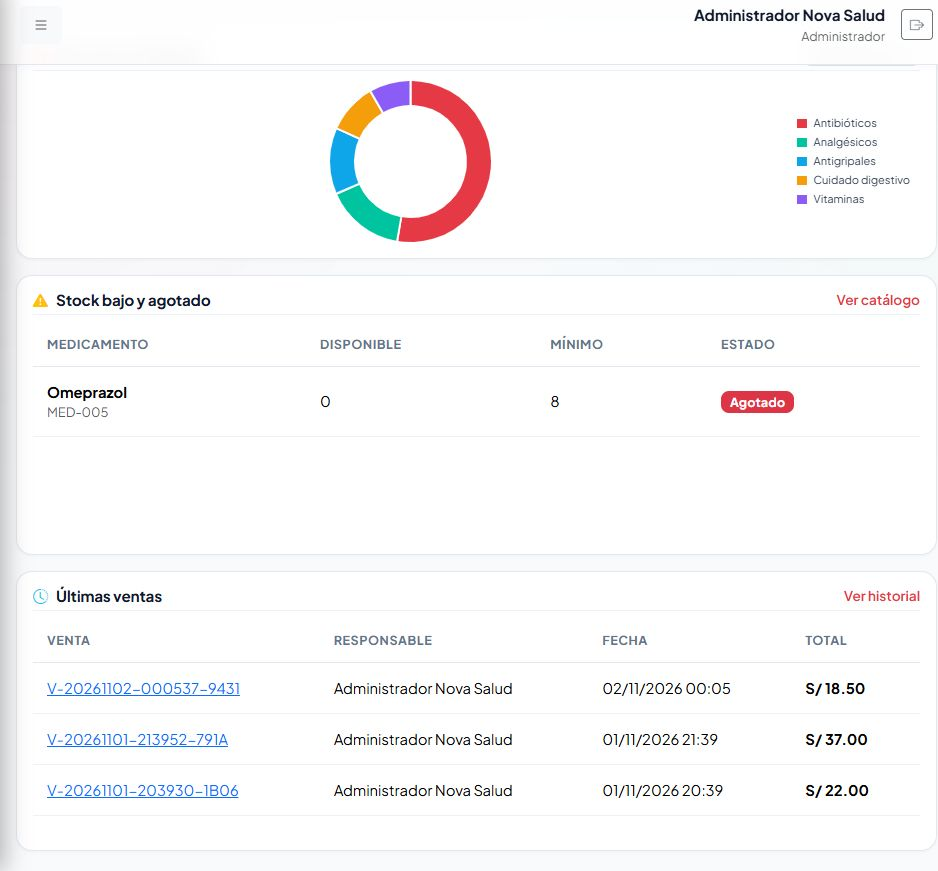
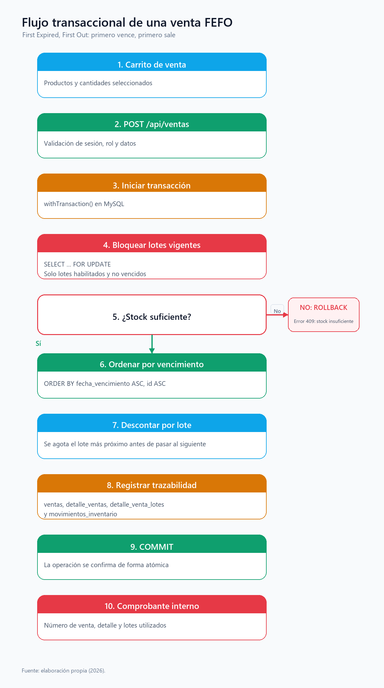

# Nova Salud — Sistema web de inventario y ventas

Aplicación fullstack para la gestión de inventario, lotes, vencimientos, ventas y reportes de una botica. El proyecto conserva la identidad visual de la aplicación PHP original y la migra a una arquitectura desacoplada con **React + Vite**, **Node.js + Express** y **MySQL**.



## Funcionalidades

- Inicio de sesión con JWT, contraseñas cifradas con bcrypt y roles **administrador** / **vendedor**.
- Dashboard con stock disponible, ventas del día, ingresos, lotes próximos a vencer, lotes vencidos y alertas de stock bajo.
- Catálogo de medicamentos con categorías, precios, stock mínimo e imágenes.
- Registro y control de lotes con fecha de ingreso, vencimiento, cantidad y bloqueo.
- Clasificación automática de vencimientos y configuración de días de anticipación.
- Inventario con movimientos auditables y ajustes de entrada/salida.
- Punto de venta con búsqueda, carrito, validación de stock y **venta FEFO transaccional**.
- Historial de ventas, comprobante interno y detalle de lotes utilizados.
- Reportes de ventas, productos más vendidos y stock, con exportación **CSV** y **PDF**.
- Administración de usuarios y configuración de alertas.

## Stack

| Capa | Tecnologías |
| --- | --- |
| Frontend | React 19, Vite, React Router, Bootstrap 5, Bootstrap Icons, Formik, Yup, Axios, Chart.js |
| Backend | Node.js, Express 5, mysql2, jsonwebtoken, bcryptjs, multer, pdfkit, helmet, cors |
| Base de datos | MySQL / MariaDB (`bd_botica`) |
| Pruebas | Smoke test de API con 17 comprobaciones |

## Estructura

```text
Proyecto_NovaSalud/
├── app/                     # Aplicación PHP original (se conserva)
├── backend/                 # API REST Node.js + Express
│   ├── src/
│   │   ├── config/          # Variables de entorno y pool MySQL
│   │   ├── middleware/      # JWT, roles, errores y uploads
│   │   ├── routes/          # Endpoints REST
│   │   └── services/        # Lógica de negocio y FEFO
│   ├── scripts/             # Instalación de BD y smoke test
│   └── uploads/             # Imágenes subidas (no versionadas)
├── frontend/                # SPA React + Vite
│   ├── src/
│   │   ├── components/
│   │   ├── contexts/
│   │   ├── pages/
│   │   └── styles/
│   └── public/
├── database/                # Esquema y datos demostrativos
├── docs/                    # Documentación, diagramas y evidencias
├── archivos/                # Formato oficial del trabajo final
├── iniciar_todo.bat         # Lanzador de MySQL, API y frontend
└── README.md
```

## Inicio rápido

### Requisitos

- Node.js 20 o superior.
- MySQL o MariaDB (el proyecto se probó con XAMPP).
- Git (opcional, para clonar el repositorio).

### Opción A: lanzador automático (Windows)

1. Inicia XAMPP o asegúrate de que MySQL esté activo.
2. Ejecuta `iniciar_todo.bat` desde la raíz del proyecto.
3. El script verifica dependencias, inicia la API y el frontend, espera a que la API responda y abre `http://localhost:5173`.

El lanzador detecta si los puertos `3306`, `4000` o `5173` ya están en uso para no duplicar servicios.

### Opción B: instalación manual

```bat
:: 1. Backend
cd backend
copy .env.example .env
npm.cmd install
npm.cmd run db:setup
npm.cmd start

:: 2. Frontend (en otra terminal)
cd frontend
npm.cmd install
npm.cmd run dev
```

Abrir `http://localhost:5173`.

### Compilación de producción

```bat
cd frontend
npm.cmd run build

cd ..\backend
npm.cmd start
```

Cuando existe `frontend/dist`, Express sirve la SPA compilada en `http://localhost:4000`.

## Variables de entorno

El backend usa `backend/.env`. Toma como base `backend/.env.example`:

```env
PORT=4000
DB_HOST=127.0.0.1
DB_PORT=3306
DB_NAME=bd_botica
DB_USER=root
DB_PASSWORD=
JWT_SECRET=cambiar-en-produccion
JWT_EXPIRES=8h
CORS_ORIGIN=http://localhost:5173,http://127.0.0.1:5173
ADMIN_USUARIO=admin
ADMIN_PASSWORD=NovaSalud2026
SELLER_USUARIO=vendedor
SELLER_PASSWORD=Vendedor2026
```

> `backend/.env` está excluido de Git. No publiques secretos reales.

## Usuarios de demostración

| Rol | Usuario | Contraseña |
| --- | --- | --- |
| Administrador | `admin` | `NovaSalud2026` |
| Vendedor | `vendedor` | `Vendedor2026` |

Las cuentas se crean con `npm.cmd run db:setup`. Si el usuario ya existe, el script no cambia su contraseña.

## API REST

La API escucha por defecto en `http://localhost:4000`. Todas las rutas, excepto el login y el health check, requieren `Authorization: Bearer <token>`.

| Método | Ruta | Descripción |
| --- | --- | --- |
| `GET` | `/api/health` | Estado del servicio |
| `POST` | `/api/auth/login` | Inicio de sesión |
| `GET` | `/api/auth/me` | Usuario autenticado |
| `GET` | `/api/dashboard` | Indicadores del panel |
| `GET` | `/api/medicamentos` | Listado y búsqueda |
| `POST` | `/api/medicamentos` | Crear medicamento (admin) |
| `PUT` | `/api/medicamentos/:id` | Editar medicamento (admin) |
| `GET` | `/api/lotes` | Listado de lotes |
| `POST` | `/api/lotes` | Registrar lote (admin) |
| `GET` | `/api/lotes/vencimientos` | Lotes vencidos y próximos |
| `GET` | `/api/inventario` | Movimientos de inventario |
| `POST` | `/api/inventario/ajuste` | Ajuste de entrada/salida (admin) |
| `GET` | `/api/ventas/productos` | Productos vendibles |
| `POST` | `/api/ventas/stock-check` | Validación de stock |
| `POST` | `/api/ventas` | Registrar venta FEFO |
| `GET` | `/api/ventas` | Historial de ventas |
| `GET` | `/api/ventas/:id` | Detalle y comprobante |
| `GET` | `/api/reportes` | Datos de reportes (admin) |
| `GET` | `/api/reportes/csv` | Exportación CSV (admin) |
| `GET` | `/api/reportes/pdf` | Exportación PDF (admin) |
| `GET` | `/api/usuarios` | Usuarios y configuración (admin) |
| `POST` | `/api/usuarios` | Crear usuario (admin) |
| `PUT` | `/api/usuarios/config` | Guardar días de alerta (admin) |

## Lógica FEFO

FEFO significa **First Expired, First Out**: primero vence, primero sale. Al confirmar una venta, el backend:

1. Abre una transacción.
2. Bloquea los lotes vigentes con `FOR UPDATE`.
3. Verifica que el stock sea suficiente.
4. Ordena los lotes por fecha de vencimiento.
5. Descuenta primero el lote más próximo a vencer.
6. Registra la venta, el detalle, los lotes utilizados y los movimientos de inventario.
7. Confirma con `COMMIT` o revierte todo con `ROLLBACK` si algo falla.



## Pruebas

Con el backend en ejecución y la base de datos configurada:

```bat
cd backend
npm.cmd run test:smoke
```

Resultado esperado: **17 comprobaciones aprobadas, 0 fallidas**. El smoke test cubre autenticación, dashboard, medicamentos, lotes, inventario, ventas, reportes y usuarios.

## Documentación académica

- [Formato oficial completado](docs/FORMATO_TRABAJO_FINAL_LLENADO.docx)
- [Documentación técnica de la migración](docs/MIGRACION_REACT_NODE.md)
- [Diagramas y evidencias](docs/img/)
- [Documentación de la aplicación PHP original](docs/DOCUMENTACION.md)
- [Registro de pruebas PHP](docs/PRUEBAS.md)

## Seguridad y datos

- No se versionan `backend/.env`, `node_modules`, `frontend/dist` ni las imágenes subidas por usuarios.
- Las contraseñas se almacenan con bcrypt.
- Las consultas usan parámetros preparados.
- Los permisos de administrador se validan en el servidor.
- Para producción se recomienda cambiar `JWT_SECRET`, usar HTTPS, restringir CORS y programar respaldos de MySQL.

## Aplicación PHP original

La carpeta `app/`, `config/`, `public/` e `index.php` conserva la aplicación PHP original. La migración a React + Node.js se encuentra en `frontend/` y `backend/`; ambos proyectos pueden ejecutarse de forma independiente.

---

Proyecto académico de desarrollo fullstack. El formato oficial del trabajo final se encuentra en `docs/FORMATO_TRABAJO_FINAL_LLENADO.docx`; completar los datos personales antes de la entrega.
