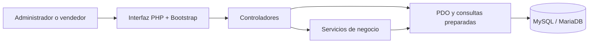
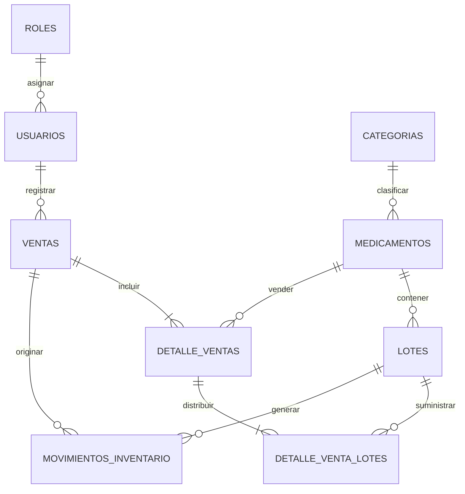
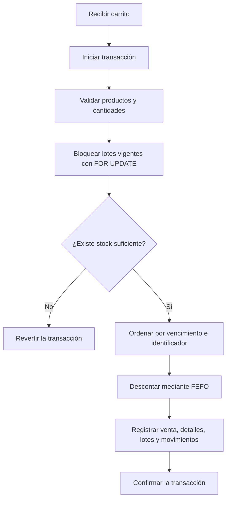

# Documentación académica — Nova Salud

## Problema identificado

Controlar manualmente los medicamentos, las existencias y las ventas puede producir errores, falta de productos, demoras y pérdida de información sobre lotes próximos a vencer.

## Objetivo

Automatizar el inventario y las ventas, conservar la trazabilidad por lote y ofrecer información actualizada para apoyar la atención y la reposición de medicamentos.

## Arquitectura

Separar la presentación, el acceso a datos y las operaciones de negocio. Centralizar la venta en un servicio transaccional para impedir actualizaciones parciales.

## Entidades y relaciones

## Registrar un medicamento y sus lotes

1. Registrar el medicamento sin asignar una fecha de vencimiento.
2. Registrar cada lote con su propio número, ingreso, vencimiento y cantidad.
3. Generar el movimiento de entrada del lote.
4. Calcular el stock total sumando las cantidades disponibles de los lotes.
5. Excluir del stock vendible los lotes vencidos o bloqueados.

## Controlar vencimientos

1. Leer los días configurados para la alerta.
2. Comparar cada fecha de vencimiento con la fecha del servidor.
3. Clasificar como vencido al lote cuya fecha sea igual o anterior a hoy.
4. Clasificar como próximo al lote que venza dentro del periodo configurado.
5. Clasificar como vigente al lote que supere ese periodo.
6. Mantener el historial aunque la cantidad disponible llegue a cero.

## Registrar una venta mediante FEFO

Conservar el precio unitario dentro del detalle de venta para mantener el valor histórico aunque el precio actual cambie.

## Seguridad aplicada

- Utilizar consultas preparadas con PDO.
- Generar contraseñas mediante `password_hash` y verificarlas con `password_verify`.
- Regenerar la sesión después de iniciar sesión.
- Validar permisos de administrador y vendedor en el servidor.
- Proteger formularios mediante tokens CSRF.
- Escapar contenido mediante codificación HTML.
- Validar imágenes por contenido, extensión permitida y tamaño.
- Ocultar directorios internos mediante reglas de Apache.
- Mostrar mensajes controlados sin revelar credenciales en las pantallas normales.

## Guía básica de uso

1. Iniciar sesión.
2. Registrar categorías de demostración mediante el SQL o utilizar las existentes.
3. Registrar medicamentos.
4. Registrar uno o varios lotes por medicamento.
5. Consultar vencimientos y stock bajo.
6. Registrar ajustes únicamente desde Inventario.
7. Abrir Punto de venta, seleccionar productos y confirmar.
8. Consultar el comprobante, los lotes utilizados y el historial.
9. Filtrar los reportes y exportar archivos CSV.

## Alcance

Generar comprobantes internos para demostración. No implementar facturación electrónica, recetas, información farmacológica oficial, devoluciones ni anulación con reversión de stock en esta primera versión.
