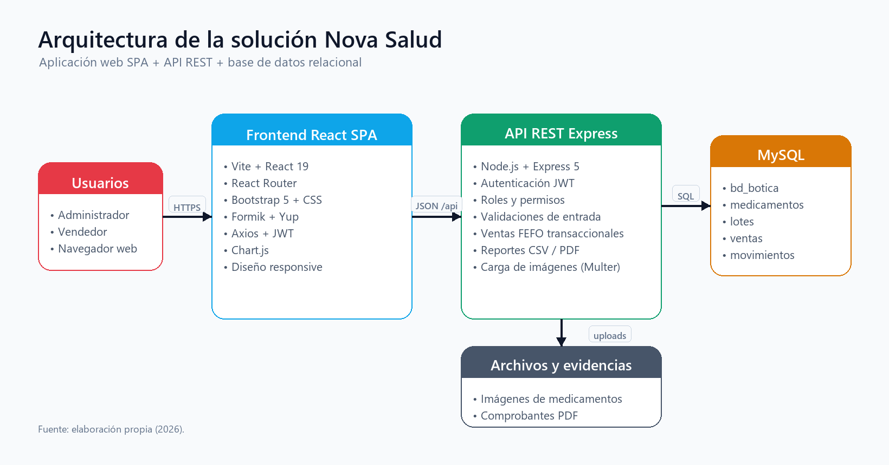
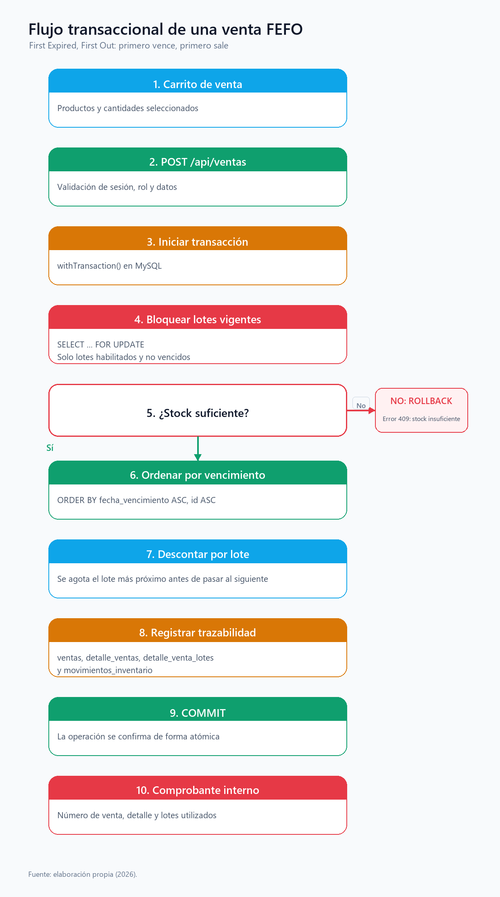

# Migración de Nova Salud a React + Node.js + MySQL

## 1. Objetivo

Documentar la migración de la aplicación PHP de Nova Salud a una arquitectura fullstack desacoplada, conservando las funciones de inventario, lotes, vencimientos, ventas FEFO, reportes y administración de usuarios, así como la identidad visual Bootstrap de la botica.

## 2. Arquitectura

```text
Navegador
   │
   ▼
SPA React + Vite (5173 en desarrollo)
   │  Axios / JSON
   ▼
API REST Node.js + Express (4000)
   │  mysql2 (pool)
   ▼
MySQL / MariaDB — bd_botica
```

En producción, Vite compila la SPA en `frontend/dist` y Express la sirve desde el mismo puerto de la API. En desarrollo, Vite usa un proxy hacia `http://localhost:4000` para `/api` y `/uploads`.



## 3. Decisiones de diseño

| Decisión | Motivo |
| --- | --- |
| `mysql2` con SQL directo en lugar de un ORM | La venta FEFO requiere transacciones, `FOR UPDATE` y control explícito de los lotes; el SQL directo hace visible la lógica y evita magia del ORM. |
| JWT con roles | Permite separar la API de la sesión PHP y proteger rutas de administrador. |
| React + Vite | Desarrollo rápido, rutas SPA, componentes reutilizables y build estático. |
| Bootstrap 5 | Conserva el diseño, los colores, las tarjetas, las tablas y los formularios de la aplicación original. |
| Express sirve `frontend/dist` | Simplifica el despliegue: un solo servicio publica la SPA y la API. |
| Variables de entorno | Evita credenciales y secretos dentro del código versionado. |

## 4. Estructura del backend

```text
backend/
├── src/
│   ├── app.js                 # Composición de Express, CORS, Helmet, estáticos
│   ├── server.js              # Arranque y cierre ordenado
│   ├── config/
│   │   ├── env.js             # Variables de entorno
│   │   └── db.js              # Pool mysql2
│   ├── middleware/
│   │   ├── auth.js            # Verificación JWT
│   │   ├── roles.js           # requireAdmin
│   │   ├── upload.js          # Multer para imágenes
│   │   └── error.js           # 404 y manejo centralizado de errores
│   ├── routes/
│   │   ├── auth.js
│   │   ├── dashboard.js
│   │   ├── medicamentos.js
│   │   ├── lotes.js
│   │   ├── inventario.js
│   │   ├── ventas.js
│   │   ├── reportes.js
│   │   └── usuarios.js
│   └── services/
│       └── ventaService.js    # Transacción FEFO
├── scripts/
│   ├── setup-db.js            # Esquema, usuarios demo y datos
│   └── smoke-test.js          # 17 comprobaciones de API
├── assets/                    # Logo para PDF
└── uploads/                   # Imágenes de medicamentos
```

## 5. Estructura del frontend

```text
frontend/
├── src/
│   ├── api/client.js          # Axios + token + manejo de 401
│   ├── components/            # Layout, sidebar, topbar, tablas, modales, toasts
│   ├── contexts/              # Autenticación y notificaciones
│   ├── pages/                 # Login, dashboard, medicamentos, lotes, etc.
│   ├── styles/                # react.css y estilos heredados
│   ├── App.jsx                # Rutas protegidas y de administrador
│   └── main.jsx               # Bootstrap de React
├── public/assets/img/         # Logos de Nova Salud
└── vite.config.js             # Proxy /api y /uploads
```

## 6. Modelo de datos

La base `bd_botica` conserva las entidades principales:

- `roles` y `usuarios`.
- `categorias` y `medicamentos`.
- `lotes` con vencimiento, cantidad inicial y cantidad disponible.
- `ventas` y `detalle_ventas`.
- `detalle_venta_lotes` para trazabilidad por lote.
- `movimientos_inventario` para entradas, salidas y ajustes.
- `configuracion` para los días de alerta de vencimiento.

Las relaciones mantienen integridad referencial y los precios se guardan en el detalle de venta para conservar el valor histórico.

## 7. Venta FEFO

```text
POST /api/ventas
   │
   ├─ Validar carrito y cantidades
   ├─ BEGIN
   ├─ SELECT lotes vigentes ... FOR UPDATE
   ├─ Verificar stock suficiente
   ├─ Ordenar por fecha_vencimiento ASC, id ASC
   ├─ Descontar cantidad de cada lote
   ├─ INSERT ventas, detalle_ventas, detalle_venta_lotes
   ├─ INSERT movimientos_inventario
   ├─ COMMIT
   └─ Si falla: ROLLBACK y respuesta 4xx/5xx
```

La venta no descuenta lotes vencidos ni bloqueados y nunca deja cantidades negativas.



## 8. Seguridad

- Contraseñas con `bcryptjs` y comparación segura.
- JWT firmado con `JWT_SECRET`, expiración configurable y verificación en cada ruta protegida.
- Autorización por rol en el servidor (`requireAdmin`), no solo en la interfaz.
- Consultas preparadas con `mysql2`.
- Validación de entradas y límites de tamaño en Express.
- Carga de imágenes con Multer, tipos permitidos y nombres aleatorios.
- Helmet, CORS restringido y limitación de intentos de login.
- `backend/.env` fuera del repositorio.

## 9. Pruebas y evidencias

- Smoke test de API: **17/17** comprobaciones aprobadas.
- Pruebas de interfaz con roles administrador y vendedor.
- Venta real registrada con descuento FEFO y comprobante interno.
- Exportación CSV/PDF verificada.
- Build de producción servido por Express.
- Capturas en `docs/img/`.

## 10. Despliegue

### Desarrollo

```bat
cd backend
npm.cmd install
npm.cmd run db:setup
npm.cmd start

cd ..\frontend
npm.cmd install
npm.cmd run dev
```

### Producción

```bat
cd frontend
npm.cmd run build

cd ..\backend
npm.cmd start
```

Express detecta `frontend/dist` y sirve la SPA. Se recomienda:

- HTTPS y un proxy inverso.
- `JWT_SECRET` robusto y distinto al de desarrollo.
- CORS limitado al dominio real.
- Respaldos programados de MySQL.
- Monitoreo de logs y plan de recuperación.
- Rotación de contraseñas de demostración.

## 11. Correspondencia PHP → React/Node

| Funcionalidad PHP | Implementación actual |
| --- | --- |
| Sesiones y `password_verify` | JWT + bcryptjs |
| Controladores en `app/Controllers` | Rutas Express en `backend/src/routes` |
| `app/Core/Database.php` (PDO) | Pool `mysql2` en `backend/src/config/db.js` |
| Vistas PHP + Bootstrap | Componentes React + Bootstrap |
| Servicio de venta transaccional | `backend/src/services/ventaService.js` |
| Reportes CSV/PDF | `backend/src/routes/reportes.js` con pdfkit |
| Gestión de imágenes | Multer + `/uploads` |
| Roles y permisos | Middleware `authenticate` + `requireAdmin` |

## 12. Limitaciones y siguientes pasos

- El formato académico conserva placeholders de datos personales hasta que el estudiante los complete.
- No se implementó facturación electrónica ni integración con proveedores.
- El despliegue público requiere un servidor con MySQL y HTTPS; el repositorio contiene la aplicación y las instrucciones, no un hosting.
- Se recomienda agregar pruebas unitarias de servicios y pruebas E2E con Playwright en una siguiente iteración.
